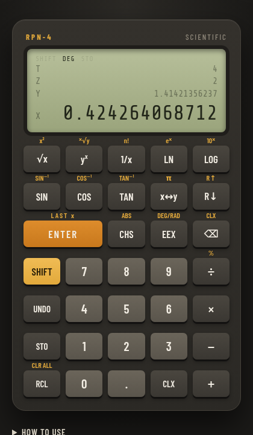

# RPN-4 Scientific Calculator

[](https://github.com/cstroie/rpn/actions/workflows/test.yml)

An HP-style Reverse Polish Notation calculator that runs in the browser. It has a four-level stack, classic stack-lift behaviour, scientific functions, memory registers and undo. There are no dependencies and no build step.

**Live demo: https://cstroie.github.io/rpn/**



## RPN in one minute

Enter the numbers first, then the operation:

| Calculation | Keys |
|-------------|------|
| 2 + 3 | `2 ENTER 3 +` |
| (3 + 4) × 5 | `3 ENTER 4 + 5 ×` |
| 7² | `7 ENTER ×` |
| √(3² + 4²) | `3 SHIFT √x 4 SHIFT √x + √x` (`SHIFT √x` is x²) |

The stack behaves like an HP calculator:

- **ENTER** copies X into Y. The next digit then replaces X.
- A two-number operation uses X and Y. The stack drops: Z moves to Y, and T is copied down into Z.
- After an operation, typing a number pushes the result up into Y, so you can chain calculations.
- **CLX** zeroes X, and the next number replaces it.

## Features

- **Arithmetic:** `+ − × ÷`, `yˣ`, `ˣ√y`, `%` (X% of Y, with Y kept)
- **Display:** STD, FIX, SCI and ENG with 0–9 digits
- **Programmer:** HEX/DEC/OCT/BIN with AND, OR, XOR, NOT, shifts and MOD
- **Statistics:** Σ+, Σ−, mean and standard deviation
- **Programming:** record keystrokes, with labels, GTO and conditional tests
- **Paper tape:** a printed log of each calculation
- **Functions:** `√x`, `x²`, `1/x`, `n!`, `LN`, `eˣ`, `LOG`, `10ˣ`, `SIN` / `COS` / `TAN` and their inverses in degrees or radians, `ABS`, `π`
- **Stack:** `x↔y`, `R↓`, `R↑`, `LAST x`, `CLX`, `CLR ALL`
- **Entry:** `CHS` (also flips the exponent sign while typing it), `EEX` for exponents such as `6.02 EEX 23`, and `⌫` to delete a digit
- **Memory:** `STO 0–9` and `RCL 0–9`
- **Undo:** up to 100 steps
- **Errors:** errors such as divide by zero or the square root of a negative number are shown on the display, and the stack is left unchanged.
- **Persistence:** the stack, memories and angle mode are kept between visits.
- **Clipboard:** click the display or press `Ctrl+C` to copy X. `Ctrl+V` pastes a number into X.
- **Share:** the **SHARE** button copies a link with the stack, memories and angle mode packed into the address.

Gold labels are second functions: press **SHIFT** (or `f`), then the key.

### Soft menus

The row of tabs above the keypad switches the five soft keys:

| Menu | Keys |
|------|------|
| **MODE** | `STD`, `FIX n`, `SCI n`, `ENG n` (press the key, then a digit), `DEG/RAD` |
| **STAT** | `Σ+` / `Σ−` add or remove X (X then shows the count), `x̄` mean, `s` standard deviation, `CLΣ` |
| **BASE** | `HEX`, `DEC`, `OCT`, `BIN` integer modes (32-bit two's complement), `MOD`; in HEX an extra row has `A`–`F` |
| **LOGIC** | `AND`, `OR`, `XOR`, `NOT`, `SL` / `SR` (shift left or right) |
| **PRGM** | `P/R` record or stop recording, `R/S` run (or stop, inside a program), `LBL n`, `GTO n`, `DEL`; with SHIFT: `CLP`, `x≠0?`, `x=0?`, `x≤y?`, `x>y?` |

### Programs

Press **P/R** and the keys you press are recorded as program steps instead of being run; the display lists the last steps. Press **P/R** again to stop recording, then **R/S** to run it. A false test skips the next step, so `x=0?` followed by `GTO 1` jumps only when X is zero. Programs are saved with the rest of the state and included in share links.

### Paper tape

The **PAPER TAPE** panel below the calculator prints every number entered and every operation with its result, like a printing calculator. You can copy it as text.

## Keyboard

| Keys | Action |
|------|--------|
| `0`–`9` `.` | digits |
| `Enter` | ENTER |
| `+ - * / ^ %` | arithmetic, yˣ, percent |
| `Backspace` | delete digit, or CLX when not typing |
| `Esc` / `Delete` | CLX / clear everything |
| `n` / `e` | CHS / EEX |
| `s` `r` `l` | x↔y, R↓, LAST x |
| `q` `i` `p` | √x, 1/x, π |
| `f` | SHIFT |
| `u` / `Ctrl+Z` | undo |

## Install and offline use

The page is a Progressive Web App. Your browser offers to install it (on a phone, use **Add to Home Screen**). After the first visit it also works offline: a service worker (`sw.js`) caches the app and refreshes it in the background, so updates appear on the next visit.

## Layout

- `rpn.js` holds the calculator engine. It does not touch the DOM and can run under Node:

  ```js
  const { RPN, format } = require('./rpn.js');
  const c = new RPN();
  c.digit('3'); c.enter(); c.digit('4'); c.op('+');
  console.log(format(c.x)); // 7
  ```
- `index.html` holds the user interface.

## Tests

```
node --test
```

The tests run the calculator engine under Node (version 18 or later) with no dependencies. GitHub Actions runs them on every push.

## License

[MIT](LICENSE) © Costin Stroie
